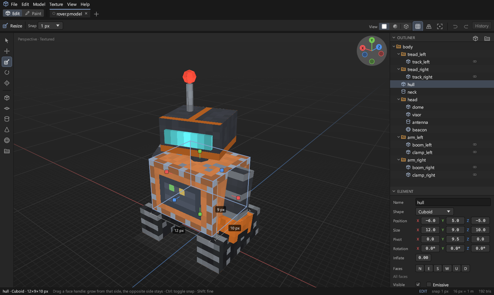
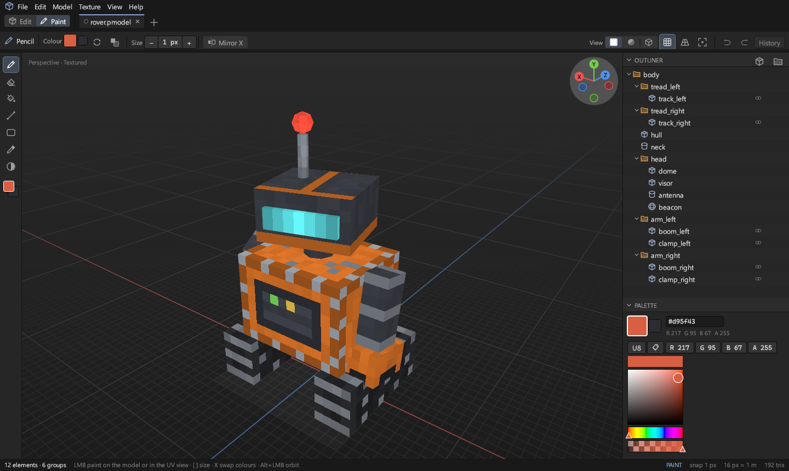

# Piska Modeler

Редактор низкополигональных моделей из кубоидов с рисованием пиксельной текстуры прямо по
модели — для движка Piska Engine, но работает и сам по себе.

*English summary below.*





## Сборка и запуск

Нужен Rust (stable) и видеокарта с Vulkan, DirectX 12 или Metal.

```bash
git clone <адрес репозитория> piska-modeler
cd piska-modeler
cargo run --release                      # пустой документ
cargo run --release -- samples/rover.pmodel
```

На Linux для окна нужны пакеты X11 / Wayland (Debian, Ubuntu:
`sudo apt install libxkbcommon-dev libwayland-dev libx11-dev libvulkan-dev`).

Без окна:

```bash
cargo run --release -- samples/rover.pmodel --screenshot shot.png --size 1440x860
cargo run --release -- samples/rover.pmodel --bench --size 1920x1080      # замер кадра
cargo run --release -- --help
```

Тесты: `cargo test --workspace` (тесты видеокарты пропускаются, если её нет).

## Что умеет

* Кубоиды, плоскости, цилиндры, конусы, шары; группы с точками вращения (суставы),
  перетаскивание в Outliner, видимость и замок.
* Гизмо: перемещение, размер «от стороны» (противоположная сторона стоит), поворот вокруг
  точки, точка вращения; привязка к сетке и углу; линейка размеров.
* Отражённые близнецы по X (правка одного повторяется на другом), Flip, Align, Distribute.
* Развёртка «коробкой» с упаковкой атласа; UV-редактор; рисование карандашом, ластиком,
  заливкой, линией, прямоугольником, пипеткой, осветлением / затемнением — прямо по модели
  и в UV, зеркально.
* Undo / Redo всего (и штрихов кисти), копирование между документами, файл восстановления.
* Экспорт `.glb` (узлы групп, текстуры внутри) и `.obj` + `.mtl`, импорт опорного меша.
* Вид рисует видеокарта (MSAA 4×); кадр перерисовывается только при изменениях — в покое
  программа не нагружает процессор. Программный растеризатор — запасной путь
  (`--cpu`), им же пользуются тесты.

### Горячие клавиши

| клавиши | действие |
|---|---|
| Tab | режим Edit / Paint |
| Q W E R P | Select, Move, Rotate, Resize, Pivot |
| B E G L U I D | Pencil, Eraser, Fill, Line, Rectangle, Picker, Shade |
| `[` `]`, X | размер кисти, обмен цветов |
| Ctrl+Z, Ctrl+Y | отменить, повторить |
| Ctrl+C, Ctrl+V, Ctrl+D | копировать, вставить, дублировать |
| Del, Ctrl+G, M, H | удалить, сгруппировать, близнец по X, скрыть |
| F, 1 / 3 / 7, 5 | показать выделенное, виды спереди / справа / сверху, проекция |
| Ctrl+N, Ctrl+S, F1 | новый документ, сохранить, список клавиш |
| ПКМ, СКМ, колесо | вращение камеры, сдвиг, масштаб |

## Формат `.pmodel`

Один текстовый файл RON: `format: "piska-model"`, `version: 1`, документ (`model`: текстуры
PNG в base64, узлы-группы и элементы с абсолютными координатами, 16 единиц = 1 м, Y вверх,
«перёд» — −Z) и раздел `baked` — модель, уже собранная для движка (вершины в метрах,
индексы, общий атлас). Движок читает только `baked`, поэтому коду игры не нужен этот
редактор. Подробно — в документации движка (`docs/api/modeler.md`) и в
`crates/engine-modeler/src/format.rs`.

## Устройство

| каталог | что |
|---|---|
| `crates/engine-modeler` | библиотека: документ, операции, история, развёртка, рисование, формат, экспорт, растеризатор; интерфейс на egui (фича `ui`), вид на wgpu (фича `gpu`) |
| `crates/piska-modeler` | программа: окно (winit + wgpu + egui), снимки, замер |
| `vendor/engine-i18n`, `vendor/engine-build`, `crates/engine-modeler/src/ui/kit.rs` | копии частей движка Piska (перевод, значок exe, визуальная система) — обновляются `python scripts/sync_from_engine.py --engine <движок>` |
| `samples/` | образцы (`cargo run -p engine-modeler --example gen_samples`) |

Лицензия: MIT или Apache-2.0 на выбор (`LICENSE-MIT`, `LICENSE-APACHE`).

---

## English summary

**Piska Modeler** is a small editor for low-poly box models with pixel textures painted
directly on the model, made for the Piska Engine but fully standalone.

* **Build & run:** `cargo run --release -- samples/rover.pmodel` (needs a Vulkan / DX12 /
  Metal GPU; on Linux install the X11/Wayland dev packages listed above).
  Headless: `--screenshot out.png --size WxH`, `--bench`. Tests: `cargo test --workspace`.
* **Modelling:** cuboids, planes, cylinders, cones, spheres, nestable groups with pivots,
  move / resize-from-face / rotate / pivot gizmos with snapping, linked X-mirror twins,
  flip / align / distribute, full undo / redo, copy-paste between documents, crash recovery.
* **Texturing:** automatic box UV with atlas packing, UV editor, pencil / eraser / fill /
  line / rectangle / picker / shade on the model or in the UV view, mirror painting.
* **Files:** `.pmodel` (RON text; textures embedded as PNG; a `baked` section with the
  engine-ready mesh), export to `.glb` and `.obj` + `.mtl`.
* **Shortcuts:** Tab toggles Edit / Paint; Q W E R P edit tools; B E G L U I D paint
  tools; Ctrl+Z / Ctrl+Y; F frames; 1 / 3 / 7 views; F1 lists every shortcut.
* **Layout:** `crates/engine-modeler` (library), `crates/piska-modeler` (app),
  `vendor/` + `ui/kit.rs` (synced copies of engine parts: `scripts/sync_from_engine.py`).
* **Licence:** MIT OR Apache-2.0.
